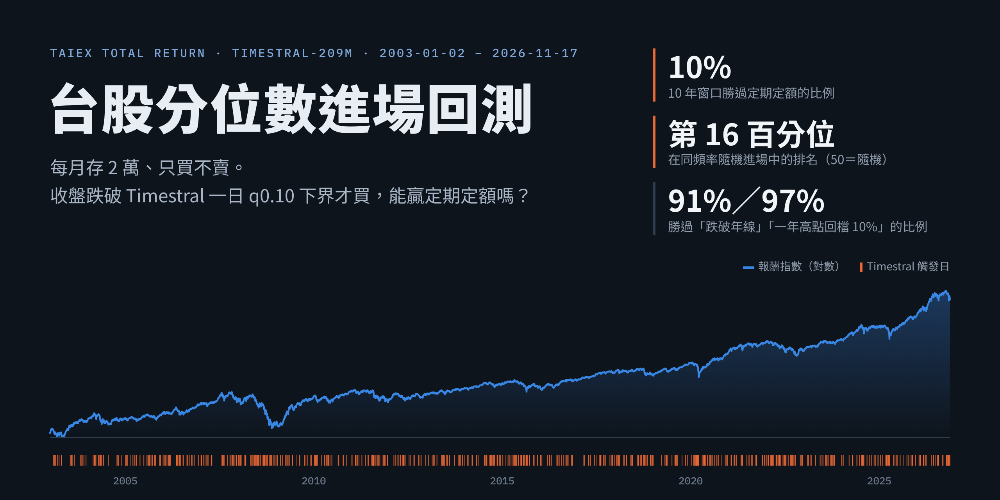

# invest-exp



時序 foundation model 的分位數預測，拿來當長期投資的進場時機，會比傳統規則好嗎？

- **標的**：證交所發行量加權股價**報酬指數**（含息），2003-01-02 至 2026-11-17。
- **投資方式**：每月第一個交易日存入 20,000 元，只買不賣；現金不計息。
- **進場規則**：條件成立當天，以收盤價把累積的現金全部買進。
- **模型**：Timestral-209M（固定 revision），CPU 推論。預測隔天收盤的分位數，收盤跌破 q0.10 下界就買。
- **評估**：10 年、20 年滾動窗口（每月一個起點）加全期間，比較期末資產。

## 結論

**論點不成立。** Timestral 的下界最準，但拿來決定進場時機，贏不了定期定額，也不如同頻率的隨機進場。

主設定：10 年窗口共 167 個，手續費 0.1425%，當日收盤成交。

| 對手 | Timestral 勝率 | 超額中位數 |
|---|---|---|
| 定期定額 | 10% | −0.36%（約 −1.5 萬元） |
| 同頻率隨機進場（500 組） | 第 16 百分位 | — |
| 經驗分位數（252 日） | 65% | +0.07% |
| GARCH(1,1)-t | 35% | −0.05% |
| 跌破 240 日均線 | 91% | +2.31% |
| 一年高點回檔 10% | 97% | +1.36% |

- **預測準不等於進場有利**：只買不賣時，差距完全取決於同一批錢的買進價格。約一半的存款買得比存入日便宜，另一半等待期間指數上漲，反而買得更貴。合計成本比定期定額高 0.37%。
- **穩健性**：免手續費、隔日成交、價格指數（不含息）、context 2048 都一樣輸給定期定額。

完整報告：[`reports/20261117T165733Z-7abf9c7.html`](reports/20261117T165733Z-7abf9c7.html)。要在本機打開，請用 `.standalone.html`，這份已內嵌 plotly，不需網路。

## 重現

需要 Python 3.12 與 [uv](https://docs.astral.sh/uv/)。

```bash
uv sync --locked
```

```bash
uv run python -m invest_exp.fetch --end 2026-11-17
```

```bash
uv run python -m invest_exp.experiment forecasts
```

```bash
uv run python -m invest_exp.experiment evaluate --run <run_id>
```

```bash
uv run python -m invest_exp.report --run <run_id>
```

- `fetch`：抓證交所原始資料，可接續，已存檔的過去月份不重抓。
- `forecasts`：產生 Timestral 與 GARCH 的預測，CPU 約 1 小時，會建立新的 run 目錄。
- `evaluate`：同一個 run 已有結果時會拒絕執行，不覆蓋舊結果。

測試：

```bash
uv run pytest -q -W error
```

## 稽核

全部產出都在版控中：
- `data/raw/twse/`：證交所原始 JSON 與 `fetch_log.csv`（每次請求的網址、時間、SHA256）。
- `runs/<run_id>/`：
  - 資料快照
  - 每日預測
  - 訊號
  - 每個窗口的結果
  - 主情境的每筆買進
  - `manifest.json`（commit、套件版本、模型 revision、每個檔案的 SHA256）

## 限制

- 只測了一個市場、一個模型。20 年窗口高度重疊，全期間只有一個樣本。
- Timestral 的預訓練資料未公開，可能看過台股資料，回測期幾乎都在發布前。就算有洩漏，也只會偏向模型，不影響「輸給定期定額」的結論。
- 未計稅；也沒考慮實際投資工具（例如 0050）的追蹤誤差與管理費。

## 文件

| 路徑 | 內容 |
|---|---|
| `docs/superpowers/specs/2026-11-17-quantile-entry-design.md` | 設計與事先登錄的假設 H1–H5 |
| `docs/superpowers/plans/2026-11-17-quantile-entry.md` | 實作計畫 |
| `docs/superpowers/milestones/M1-quantile-entry.md` | 結果、與 spec 的差異、審查紀錄、待辦 |
| `scripts/cover.py` | 封面：由正式 run 產生 `docs/assets/cover.html`，再以瀏覽器截圖成 1280×640、2 倍解析度的 PNG |
